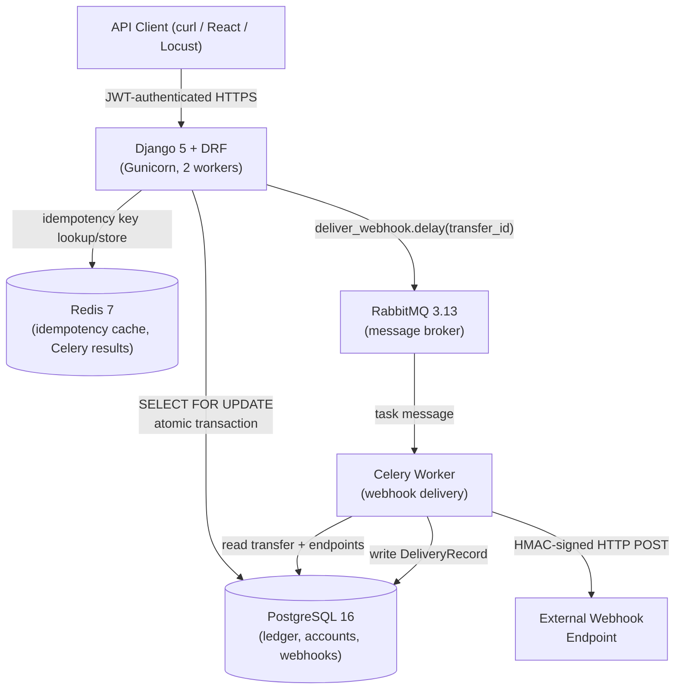

# PayLedger

> A payments ledger and webhook delivery service — built as a portfolio project demonstrating
> backend engineering fundamentals: double-entry bookkeeping, idempotency, distributed task
> queues, and concurrent-safe database operations.

---

## Architecture



---

## Tech Stack

| Layer | Technology |
|---|---|
| Language | Python 3.12 |
| Web framework | Django 5.0 + Django REST Framework 3.15 |
| Auth | JWT (`djangorestframework-simplejwt`) |
| Database | PostgreSQL 16 |
| Cache / Idempotency | Redis 7 + `django-redis` |
| Task queue | Celery 5.4 + RabbitMQ 3.13 |
| HTTP client (webhooks) | `httpx` |
| Containerisation | Docker + Docker Compose |
| Testing | pytest + `pytest-django` |
| Load testing | Locust |

---

## Project Layout

```
payLedger/
├── payledger/          # Django project (settings, urls, celery, wsgi)
├── accounts/           # Account model, registration, CRUD API
├── ledger/             # Transfer model, LedgerEntry, idempotency, services
├── webhooks/           # WebhookEndpoint, WebhookDelivery, Celery tasks, signing
├── tests/              # pytest tests (transfers, webhooks, idempotency)
├── load_test/          # Locust load-test file + seed script
├── Dockerfile
├── docker-compose.yml
├── requirements.txt
├── .env.example
├── README.md
└── DESIGN.md
```

---

## Quick Start (Docker)

```bash
# 1. Clone the repo
git clone https://github.com/your-username/payLedger.git
cd payLedger

# 2. Copy environment file (default values work for local Docker)
cp .env.example .env

# 3. Build images and start all services
docker-compose up --build

# 4. (Optional) Create a Django superuser for the admin panel
docker-compose exec web python manage.py createsuperuser
```

Services after `docker-compose up`:

| Service | URL |
|---|---|
| Django API | http://localhost:8000 |
| Django Admin | http://localhost:8000/admin |
| RabbitMQ UI | http://localhost:15672 (guest/guest) |
| PostgreSQL | localhost:5432 |
| Redis | localhost:6379 |

---

## API Reference

### Authentication

```bash
# Register a new user
curl -X POST http://localhost:8000/api/auth/register/ \
  -H "Content-Type: application/json" \
  -d '{"username": "alice", "password": "securepass123"}'

# Get a JWT token
curl -X POST http://localhost:8000/api/auth/token/ \
  -H "Content-Type: application/json" \
  -d '{"username": "alice", "password": "securepass123"}'

# Response:
# {"access": "<jwt>", "refresh": "<jwt>"}

export TOKEN="<access_token_from_above>"
```

### Accounts

```bash
# Create an account
curl -X POST http://localhost:8000/api/accounts/ \
  -H "Authorization: Bearer $TOKEN" \
  -H "Content-Type: application/json" \
  -d '{"name": "Main Wallet", "currency": "USD"}'

# List my accounts
curl http://localhost:8000/api/accounts/ \
  -H "Authorization: Bearer $TOKEN"
```

### Transfers

```bash
# Create a transfer (Idempotency-Key header is required)
curl -X POST http://localhost:8000/api/transfers/ \
  -H "Authorization: Bearer $TOKEN" \
  -H "Content-Type: application/json" \
  -H "Idempotency-Key: $(uuidgen)" \
  -d '{
    "source_account": "<source-uuid>",
    "destination_account": "<dest-uuid>",
    "amount": 1000,
    "description": "Payment for coffee"
  }'

# List transfers (with filters)
curl "http://localhost:8000/api/transfers/list/?status=completed&created_after=2024-01-01T00:00:00Z" \
  -H "Authorization: Bearer $TOKEN"

# Get a specific transfer
curl http://localhost:8000/api/transfers/<uuid>/ \
  -H "Authorization: Bearer $TOKEN"
```

### Ledger Entries (Transaction History)

```bash
curl "http://localhost:8000/api/ledger-entries/?account=<account-uuid>" \
  -H "Authorization: Bearer $TOKEN"
```

### Webhooks

```bash
# Register a webhook endpoint
curl -X POST http://localhost:8000/api/webhooks/endpoints/ \
  -H "Authorization: Bearer $TOKEN" \
  -H "Content-Type: application/json" \
  -d '{
    "url": "https://your-server.com/webhook",
    "events": ["transfer.completed"],
    "secret": "your-webhook-secret"
  }'

# View delivery logs
curl http://localhost:8000/api/webhooks/deliveries/ \
  -H "Authorization: Bearer $TOKEN"
```

### Verifying a Webhook Signature (Python example)

```python
import hashlib, hmac, time

def verify(secret: str, body: bytes, header: str) -> bool:
    parts = dict(item.split("=", 1) for item in header.split(","))
    timestamp = int(parts["t"])
    received_sig = parts["v1"]

    if abs(time.time() - timestamp) > 300:
        return False  # replay attack

    signed_string = f"{timestamp}.".encode() + body
    expected = hmac.new(secret.encode(), signed_string, hashlib.sha256).hexdigest()
    return hmac.compare_digest(expected, received_sig)
```

---

## Running Tests

```bash
# Inside Docker (recommended — shares the DB and Redis)
docker-compose exec web pytest tests/ -v

# Locally (requires PostgreSQL + Redis running locally)
# Set DATABASE_URL and REDIS_URL env vars first
pip install -r requirements.txt
pytest tests/ -v
```

Test coverage includes:
- ✅ Successful transfer + double-entry ledger entries
- ✅ Insufficient funds rejection
- ✅ Idempotent replay (same key, same body)
- ✅ Idempotency conflict (same key, different body)
- ✅ Concurrent transfers — no double-spend
- ✅ Unauthorised account access
- ✅ Webhook HMAC signing and verification
- ✅ Webhook retry on 5xx
- ✅ Webhook delivery on connection error
- ✅ Back-off delay formula

---

## Load Test

### 1. Seed test data

```bash
docker-compose exec web python load_test/seed.py
```

### 2. Run Locust (headless, 60-second run)

```bash
# From the project root (with the stack running)
locust -f load_test/locustfile.py \
    --headless \
    --users 50 \
    --spawn-rate 10 \
    --run-time 60s \
    --host http://localhost:8000
```

Or open the interactive UI:

```bash
locust -f load_test/locustfile.py --host http://localhost:8000
# then open http://localhost:8089
```

---

## Results

Measured locally with Locust: 50 concurrent users, 60 seconds, Docker Compose on a MacBook Air (4 gunicorn workers, 2 threads each). The user throttle was raised for the test via `THROTTLE_USER`.

| Endpoint | Requests | Failures | Median | p95 | p99 |
|---|---|---|---|---|---|
| POST /api/transfers/ | 4,546 | 0 | 16 ms | 68 ms | 190 ms |
| GET /api/transfers/list/ | 2,613 | 0 | 11 ms | 85 ms | 140 ms |
| GET /api/webhooks/deliveries/ | 1,737 | 0 | 7 ms | 16 ms | 30 ms |
| All requests | 8,996 | 0 | 13 ms | 64 ms | 260 ms |

Throughput: about 150 requests/s overall, about 76 transfers/s on the write path.

**Ledger reconciliation:** after all load runs, 9,255 transfers were recorded, the destination balance was 9,255, and the source balance was 100,000,000 − 9,255 = 99,990,745. The total was unchanged, so there was no double-spend under concurrent load.

Raw Locust output is in `load_test/results_stats.csv`. Webhook delivery throughput was not load-tested.

To reproduce: `docker compose run --rm -e PYTHONPATH=/app web python load_test/seed.py`, then `locust -f load_test/locustfile.py --headless --users 50 --spawn-rate 10 --run-time 60s --host http://localhost:8000`.
